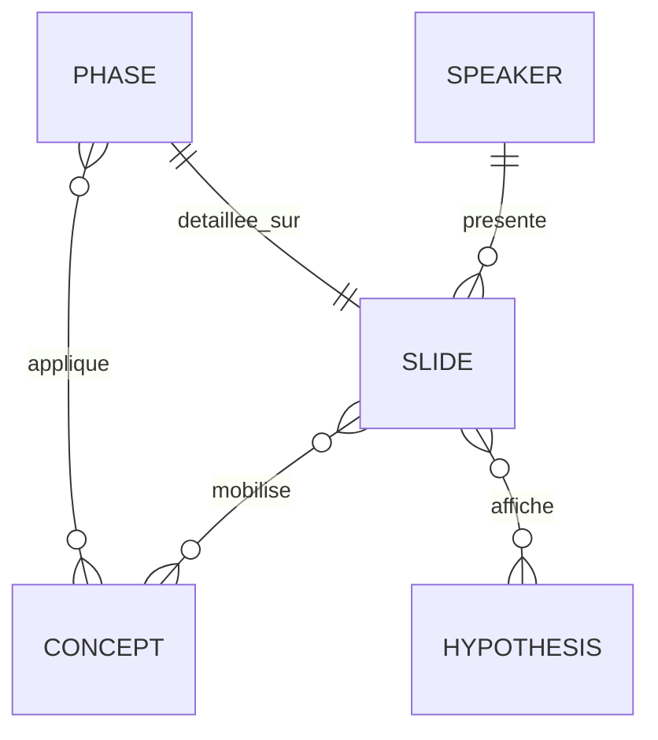

# Phase 1 — Data Model

Les entités ci-dessous sont implémentées sous forme de structures Python (listes et
dictionnaires, ou dataclasses) dans `deck/content.py`.

## Speaker (Orateur)

| Champ | Type | Règle |
|-------|------|-------|
| `code` | `"A"`, `"B"` ou `"C"` | unique |
| `name` | str | A = Raphaël, B = Caupcine, C = Fares |
| `slides` | list[int] | A = [1, 2, 3, 4, 13] ; B = [5, 6, 7, 8] ; C = [9, 10, 11, 12] |

## Slide

| Champ | Type | Règle |
|-------|------|-------|
| `number` | int | 1 à 14, unique, ordre de la trame FR-005 (14 = Questions et sources) |
| `title` | str | titre-phrase ; ≤ 110 caractères ; porte le message clé |
| `layout` | enum | `title`, `bullets`, `two_columns`, `cards`, `diagram`, `closing` |
| `bullets` | list[str] | ≤ 6 éléments |
| `visual` | enum ou None | `iceberg`, `timeline`, `seci`, `ba`, `risk_benefit`, `trust`, `kpi`, None |
| `visual_data` | dict | libellés affichés dans le schéma (comptés dans les mots affichés) |
| `concepts` | list[str] | clés de `Concept` ; non vide pour les slides 4 à 12 |
| `hypothesis_flag` | bool | True si la slide affiche une donnée hypothétique → mention « Hypothèse » visible |
| `speaker` | `"A"`, `"B"`, `"C"` ou `"ALL"` | conforme à `Speaker.slides` ; `ALL` pour la slide 14 |
| `notes` | str | commence par `[Orateur X – Prénom]` ; texte rédigé et non simples mots-clés |
| `transition` | str ou None | obligatoire sur les slides 4, 8 et 12 (passage de relais) et sur la 13 (vers les questions) |

**Mots affichés** = mots de `bullets` + `visual_data` (hors titre et pied de page) ; doit
rester ≤ 40.

## Hypothesis (Hypothèse)

| Champ | Type | Règle |
|-------|------|-------|
| `id` | str | `H1`… |
| `statement` | str | ex. « 40 ingénieurs conception/qualité Quechua en France » |
| `rationale` | str | justification courte (notes de la slide 3) |
| `used_on` | list[int] | slides où l'hypothèse est réutilisée (3, 7, 9, 12…) |

Hypothèses minimales :
- H1 : périmètre Quechua conception et qualité.
- H2 : 40 ingénieurs en France.
- H3 : 15 personnes à Hô Chi Minh-Ville.
- H4 : 18 mois en 3 vagues de gammes.
- H5 : contraintes qualité, délais et sécurité produit.
- H6 : MIAGE Conseil a déjà audité Decathlon.

## Concept (Concept du cours)

| Champ | Type | Règle |
|-------|------|-------|
| `key` | str | ex. `seci`, `ba`, `grundstein_facettes`, `postulats`, `polanyi`, `bonne_intelligence`, `iiia_phases`, `patrimoniale_innovation`, `entreprise_etendue`, `socio_technique` |
| `label` | str | nom affiché |
| `reference` | str | auteur(s) et année, repris dans la slide de sources |
| `application` | str | application au cas Quechua (une phrase) |

Chaque `Concept` doit être utilisé par au moins une slide. Chaque `reference` apparaît sur
la slide 14.

## Phase (Phase de la démarche)

| Champ | Type | Règle |
|-------|------|-------|
| `index` | 1 à 4 | 1 Repérer et préserver, 2 Transférer (SECI), 3 Partager (Ba), 4 Actualiser et piloter |
| `months` | str | M0–M3 / M3–M15 (3 vagues) / dès M3, permanent / M0–M18 et au-delà |
| `actions` | list[str] | ≥ 2 |
| `actors` | list[str] | ≥ 1 (ex. experts FR, ingénieurs VN, référents passeurs, responsable KM) |
| `deliverable_or_kpi` | list[str] | ≥ 1 (FR-008) |
| `slide` | int | 8, 9, 10, 12 |
| `grundstein` | list[str] | facettes couvertes (repérer, préserver, valoriser, actualiser, manager) |

## Relations

## Transitions d'état (cycle de vie du livrable)

`brouillon (content.py)` → `généré (.pptx)` → `vérifié (check_deck OK)` →
`importé (Google Slides, contrôle visuel)` → `répété (chrono OK)` → `envoyé (2026-11-09)`.
